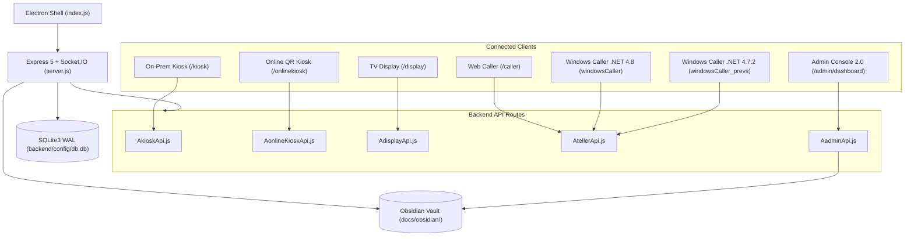

# OpenQ Knowledge Vault & Memory Cortex

> [!info] Graphify + Obsidian Integration
> This vault serves as the persistent architectural memory, debugging ledger, and operational note-taking hub for the **OpenQ Queue Management System**. It is indexed by **Graphify** (`graphify-out/GRAPH_REPORT.md` & `graphify-out/graph.html`) and connected to the Admin Console's **Notes & Memory** workspace.

## Core Navigation (Map of Content)

- **Architecture & Modules**
  - [[System-Architecture|OpenQ Full-Stack System Architecture]]
  - [[Windows-Caller-Desktop|Windows Caller Desktop Apps (v4.8 & v4.7.2)]]
- **Debugging & Security Audits**
  - [[Systematic-Bug-Audit|Systematic Debugging & API Security Ledger]]
- **Operational Memory & Admin Notes**
  - [[Welcome-Memory|Operational Memory & Branch Notes]]

## High-Level Architecture Diagram

## Graphify Knowledge Map Outputs

- **Audit Report:** `graphify-out/GRAPH_REPORT.md`
- **Interactive Visualization:** `graphify-out/graph.html`
- **Graph Data:** `graphify-out/graph.json`
- **Generated Node Vault:** `graphify-out/obsidian/`

